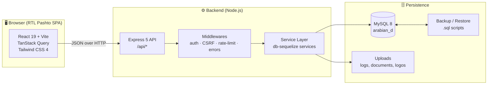

<div align="center">

# 🏗️ MD Tower Construction Company

### Integrated Management System

**A full-stack, bilingual (Pashto RTL) ERP platform for construction, real-estate sales & rentals, procurement, HR, and double-entry accounting.**

[](https://nodejs.org/)
[](https://www.typescriptlang.org/)
[](https://react.dev/)
[](https://vitejs.dev/)
[](https://expressjs.com/)
[](https://www.mysql.com/)
[](https://sequelize.org/)
[](#-license)

**Internal codename:** `Arabian D`

**Completed:** 2026 July 02 · **Language:** Pashto (RTL) · **Currency:** AFN / USD / PKR

</div>

---

## 📖 Table of Contents

- [Overview](#-overview)
- [Key Features](#-key-features)
- [Tech Stack](#-tech-stack)
- [System Architecture](#-system-architecture)
- [Repository Structure](#-repository-structure)
- [Getting Started](#-getting-started)
  - [Prerequisites](#prerequisites)
  - [1. Database Setup](#1-database-setup)
  - [2. Backend Setup](#2-backend-setup)
  - [3. Frontend Setup](#3-frontend-setup)
- [Configuration](#-configuration)
- [Running the System](#-running-the-system)
- [Default Credentials](#-default-credentials)
- [User Roles & Permissions](#-user-roles--permissions)
- [API Overview](#-api-overview)
- [Testing](#-testing)
- [Production Build](#-production-build)
- [Security Notes](#-security-notes)
- [Contributing](#-contributing)
- [Authors & Credits](#-authors--credits)
- [License](#-license)

---

## 🧭 Overview

**MD Tower Construction Company — Management System** is a complete web application that manages the operational and financial lifecycle of a construction and real-estate business. It connects every department — projects, sales, rentals, procurement, human resources, currency exchange, and accounting — into a single source of truth.

The platform provides:

- **Operational control** over projects, blocks, floors, units, shops, sales, and rentals.
- **Financial accuracy** through a double-entry journal, chart of accounts, cash accounts, and fiscal periods.
- **Workforce management** covering employees, attendance, payroll, and worker documents.
- **Partner capital tracking** via a dedicated partner ("Haji") ledger and Kafil (guarantor) delegations.
- **Governance & security** with role-based access control, granular permissions, audit logs, a recycle bin, and automated backups.

The front end is a **right-to-left Pashto** interface with full **Jalali (Shamsi) calendar** support, designed to match the day-to-day workflow of an Afghan construction enterprise.

> **Note:** the repository contains only source code, configuration templates, database bootstrap scripts, and a seed backup. Runtime secrets (`Backend/.env`), `node_modules`, build output, and uploaded documents are intentionally excluded via `.gitignore`.

---

## ✨ Key Features

### 🏘️ Projects & Real Estate
- Multi-project portfolio management with full project ledger.
- Hierarchical structure: **Project → Block → Floor → Unit**.
- Configurable **unit types** (house, shop, parking, restaurant, clinic, supermarket, mosque, office, warehouse, and more).
- **Shops** management and unit availability / room-count tracking.
- Floor purposes and per-floor unit-type assignment.

### 💰 Sales & Rentals
- **Sales contracts** with attached documents and numbered receipts.
- Credit sales, contract voiding, and running balance tracking.
- **Rental contracts** with recurring receipts and tenant records.
- Automatic, prefixed document numbering (contracts, receipts, vouchers…).

### 📦 Procurement & Expenses
- **Purchases** of materials and goods, including market transactions.
- **Purchase returns** and supplier payment tracking.
- Customer / supplier bill numbers for reconciliation.
- **Expense vouchers** with configurable categories.

### 👥 People & Parties
- Unified **parties** directory (customers, suppliers, debtors) with assignable roles.
- **Company partners** and a dedicated **Haji ledger** for capital and drawings.
- **Kafil (guarantor) management** and temporary delegations.

### 🧑‍🏭 HR & Payroll
- Employee records with work periods, worker types, and start/end dates.
- Employee **documents** upload and management.
- **Attendance** tracking.
- Employee **payments / payroll**, including debt-repayment entries.
- **Misc workers** management.

### 📊 Finance & Accounting
- **Double-entry journal** with posting links to source documents.
- **Chart of accounts** (assets, liabilities, equity, income, expenses).
- **Cash accounts** and daily cash targets.
- **Currency exchange** module for dealers and transactions (AFN, USD, PKR).
- **Fiscal periods** and period control.
- **Profit & Loss** and **General Report** statements.

### 🛡️ Administration & Security
- Session-based authentication with secure cookies.
- **Role-Based Access Control (RBAC)** with 40+ granular permissions.
- Account lockout, configurable password policy, and rate limiting.
- **Audit log** of changes across the system.
- **Recycle bin** — soft delete and restore for protected records.
- Automated MySQL **backup and restore** scripts.
- Company settings: name, logo, slogan, contact details, and welcome text.

### 🎨 User Experience
- Fully **RTL Pashto** interface.
- **Jalali (Shamsi)** date picker and date filters.
- **CSV export** and print-ready headers for reports and invoices.
- Responsive dashboard with charts (Recharts).

---

## 🧱 Tech Stack

| Layer | Technology |
| --- | --- |
| **Frontend** | React 19, TypeScript, Vite 7, React Router 7, TanStack Query 5 |
| **UI / Styling** | Tailwind CSS 4, Recharts, lucide-react, RTL layout |
| **Backend** | Node.js 20+, Express 5, TypeScript, esbuild |
| **ORM / Database** | Sequelize 6 + `mysql2` on MySQL 8 (`utf8mb4`); Drizzle ORM schema (transitional) |
| **API Contract** | OpenAPI 3.1 + Orval (generated Zod schemas & React client) |
| **Auth & Security** | Cookie sessions, CSRF protection, Helmet, express-rate-limit, password policy, account lockout |
| **Logging** | Pino + pino-http |
| **Testing** | Vitest + Supertest |
| **Package Manager** | pnpm workspaces (npm compatible) |
| **Tooling** | Replit-based workspace, MySQL CLI for backup/restore |

---

## 🏛️ System Architecture



**Request flow:** the SPA calls the REST API under `/api`. Requests pass through authentication, CSRF, and rate-limiting middlewares before reaching the service layer, which enforces business rules and writes to MySQL through Sequelize. Source-document postings are linked to the double-entry journal for consistent financial reporting.

---

## 🗂️ Repository Structure

```text
md-tower-construction-company/
├── Backend/                      # API server + shared workspace packages (pnpm)
│   ├── api-server/               # Express 5 application
│   │   ├── src/
│   │   │   ├── routes/           # REST route modules (auth, sales, journal, …)
│   │   │   ├── middlewares/      # auth, CSRF, rate limits, error handling
│   │   │   └── lib/              # audit, automatic backup, logger, trash…
│   │   └── tests/                # Vitest + Supertest suites
│   ├── lib/
│   │   ├── db-sequelize/         # Models, migrations (37+), services, seed
│   │   ├── db/                   # Drizzle schema (transitional)
│   │   ├── api-spec/             # OpenAPI spec + Orval config
│   │   ├── api-zod/              # Generated Zod schemas
│   │   └── api-client-react/     # Generated React API client
│   ├── scripts/                  # dev server, backup & restore utilities
│   └── .env.example              # Environment template
│
├── Frontend/                     # React 19 + Vite 7 SPA (Pashto RTL)
│   ├── src/
│   │   ├── pages/                # Route pages (dashboard, sales, HR, reports…)
│   │   ├── components/           # Shared UI (shell, print header, date picker…)
│   │   └── lib/                  # API client, auth, jalali calendar, i18n
│   ├── scripts/serve-dist.mjs    # Static server + API proxy
│   └── index.html
│
├── DB/                           # Database bootstrap
│   ├── mysql-create-database.sql # Creates schema + application DB user
│   ├── MYSQL_SETUP.md            # MySQL setup guide
│   └── data/
│
├── Backup/                       # Seed / snapshot database backups
│   ├── latest.sql                # Primary import file
│   └── MD.sql
│
├── start-system.bat              # One-click Windows launcher
├── .gitignore
├── .gitattributes
└── README.md
```

---

## 🚀 Getting Started

### Prerequisites

Make sure the following are installed:

| Requirement | Version | Notes |
| --- | --- | --- |
| **Node.js** | 20 LTS or newer | Includes `npm`; `pnpm` recommended |
| **pnpm** | 9+ | `npm install -g pnpm` (optional but recommended) |
| **MySQL Server** | 8.0 | Must be running locally |
| **Git** | latest | To clone the repository |

> 💡 On Windows you can launch the whole system with the provided **`start-system.bat`** after completing the one-time setup below.

---

### 1. Database Setup

Create the database, the application user, and import the seed data.

**Windows (PowerShell / CMD):**

```powershell
mysql -u root -p < DB\mysql-create-database.sql
mysql -u root -p arabian_d < Backup\latest.sql
```

**macOS / Linux:**

```bash
mysql -u root -p < DB/mysql-create-database.sql
mysql -u root -p arabian_d < Backup/latest.sql
```

If your MySQL `root` account has **no password**, omit `-p`.

The bootstrap script creates:

- Database `arabian_d` (`utf8mb4` / `utf8mb4_unicode_ci`)
- Application user `arabian_d_user` with access from `localhost` and `127.0.0.1`

> ⚠️ The seed script ships with a default development password. **Change it** for any real deployment (see [Security Notes](#-security-notes)).

---

### 2. Backend Setup

```bash
cd Backend

# 1) Install dependencies (pnpm preferred; npm also works)
pnpm install

# 2) Create your local environment file
#    Windows:
copy .env.example .env
#    macOS / Linux:
cp .env.example .env

# 3) Build the API server bundle
pnpm --filter @workspace/api-server build

# 4) Start the API (watch-free dev mode)
pnpm dev
```

The API starts on **`http://localhost:17879`**.
Health check: **`http://localhost:17879/api/healthz`**

On a successful boot you will see:

```text
Database ready
Backend server is running: http://localhost:17879
```

> The `dev` script runs the compiled bundle (`api-server/dist/index.mjs`). Re-run the build after changing backend **source** files.

---

### 3. Frontend Setup

```bash
cd Frontend

# Install dependencies
pnpm install

# Build the SPA, then serve it
pnpm build
pnpm dev
```

The front end is served on **`http://localhost:5000`** (it automatically falls back to `5001`, `5002`, … if the port is busy) and proxies API calls to the backend on port `17879`.

Open the printed URL and log in.

> For hot-reload development you can use `pnpm dev:vite` instead of the pre-built static server.

---

## ⚙️ Configuration

All backend configuration lives in **`Backend/.env`** (created from `Backend/.env.example`):

| Variable | Default | Description |
| --- | --- | --- |
| `PORT` | `17879` | Backend HTTP port |
| `NODE_ENV` | `development` | Runtime environment (`development` / `production`) |
| `SESSION_SECRET` | — | **Long random secret** for signing session cookies. Generate a unique value per environment. |
| `DB_DIALECT` | `mysql` | Database dialect |
| `DB_HOST` | `127.0.0.1` | MySQL host |
| `DB_PORT` | `3306` | MySQL port |
| `DB_NAME` | `arabian_d` | Database name |
| `DB_USER` | `arabian_d_user` | Database user |
| `DB_PASSWORD` | `ArabianD@12345` | Database password (change in production) |
| `ADMIN_USERNAME` | `admin` | First admin username (used only on first boot) |
| `ADMIN_PASSWORD` | `admin123` | First admin password (used only on first boot) |

The database bootstrap values are mirrored in [`DB/mysql.env.example`](DB/mysql.env.example).

> **Never commit `Backend/.env`.** It is already listed in `.gitignore`.

---

## ▶️ Running the System

### Option A — One-click launcher (Windows)

Double-click **`start-system.bat`**. It will:

1. Create `Backend\.env` from the example if missing.
2. Ensure the `Backup` and `uploads` folders exist.
3. Build the backend and frontend if build output is missing.
4. Launch the backend and frontend in separate windows.

### Option B — Manual (recommended for development)

Open **two terminals**:

```bash
# Terminal 1 - Backend
cd Backend
pnpm dev

# Terminal 2 - Frontend
cd Frontend
pnpm dev
```

Then open the login URL printed by the frontend (`http://localhost:5000/login` by default).

### Useful backend scripts

| Command | Purpose |
| --- | --- |
| `pnpm dev` | Start the API server |
| `pnpm start` | Start the API in a production-like mode |
| `pnpm --filter @workspace/api-server test` | Run the backend test suite |
| `pnpm backup:mysql` | Create a timestamped MySQL backup |
| `pnpm restore:latest` | Restore the latest backup |
| `pnpm reset:empty` | Reset the database to an empty state |

---

## 🔑 Default Credentials

On **first boot**, if no user exists, an administrator account is created from `.env`:

```text
Username: admin
Password: admin123
```

> 🔐 **Change this password immediately** on any non-local environment, and set a strong `ADMIN_PASSWORD` and `SESSION_SECRET` before deploying.

---

## 👤 User Roles & Permissions

The seed defines an **admin** role (all permissions) plus the following operational roles:

| Role | Description |
| --- | --- |
| `admin` | Full system access |
| `manager` | General company manager (read/oversight) |
| `accountant` | Journal, accounting, parties, expenses, reports |
| `cashier` | Cash boxes, journal, accounting |
| `project_manager` | Projects, blocks, units, unit types |
| `purchase_manager` | Procurement and supplier parties |
| `sales_manager` | Sales and rentals |
| `expenses_manager` | Expenses |
| `hr_manager` | Employees and attendance |
| `exchange_manager` | Currency exchange |
| `partners_manager` | Company partners and Haji ledger |
| `reports_viewer` | Reports only |
| `auditor` | Reports + audit log + recycle bin (read-only) |
| `kafil` | Temporary operational delegate (broad transaction access) |

Permissions are fine-grained (e.g. `sales.manage`, `journal.view`, `reports.export`, `settings.manage`, `trash.manage`) and can be reassigned at runtime under **Settings → Roles**.

---

## 🔌 API Overview

**Base URL:** `http://localhost:17879/api`

| Group | Path | Description |
| --- | --- | --- |
| Health | `/healthz` | Service health status |
| Auth | `/auth` | Login, logout, session |
| Settings | `/settings` | Company settings (public + admin) |
| Users | `/users` | User management |
| Roles | `/roles` | Roles & permissions |
| Delegations | `/delegations` | Kafil delegations |
| Audit Logs | `/audit-logs` | Change history |
| Trash | `/trash` | Soft-deleted records |
| Projects | `/projects` | Projects, blocks, floors |
| Units | `/units` | Units |
| Unit Types | `/unit-types` | Unit type catalogue |
| Journal | `/journal` | Double-entry transactions |
| Cash Accounts | `/cash-accounts` | Cash boxes & daily cash |
| Parties | `/parties` | Customers / suppliers / debtors |
| Sales | `/sales` | Sales contracts & receipts |
| Rentals | `/rentals` | Rental contracts & receipts |
| Expenses | `/expenses` | Expense vouchers |
| Purchases | `/purchases` | Purchases, returns, payments |
| Employees | `/employees` | Employees, attendance, payroll |
| Exchange | `/exchange` | Currency exchange |
| Company Partners | `/company-partners` | Partner capital |
| Partners | `/partners` | Haji ledger |
| Reports | `/reports` | Profit & Loss, general reports |

The machine-readable contract is available at [`Backend/lib/api-spec/openapi.yaml`](Backend/lib/api-spec/openapi.yaml).

---

## 🧪 Testing

The backend ships with a Vitest + Supertest suite covering authentication, core flows, extended flows, party cascade behaviour, and data seeding/structure.

```bash
cd Backend
pnpm --filter @workspace/api-server test
```

Type checking:

```bash
pnpm --filter @workspace/api-server typecheck   # backend
cd Frontend && pnpm typecheck                    # frontend
```

---

## 🏭 Production Build

```bash
# Backend bundle -> Backend/api-server/dist/index.mjs
cd Backend
pnpm --filter @workspace/api-server build
NODE_ENV=production pnpm start

# Frontend static bundle -> Frontend/dist
cd Frontend
pnpm build
```

For production, run the API behind a reverse proxy (e.g. Nginx) with HTTPS, serve `Frontend/dist` as static files, set a strong `SESSION_SECRET` and `ADMIN_PASSWORD`, and schedule regular `pnpm backup:mysql` runs.

---

## 🔒 Security Notes

This repository is published as **source code** for reference. Before exposing any deployment to the internet:

1. **Rotate secrets** — set a unique, long `SESSION_SECRET` and a strong `ADMIN_PASSWORD`.
2. **Change the database password** — update both `DB/mysql-create-database.sql` and `Backend/.env`.
3. **Never commit `.env` files** — only `.env.example` belongs in version control.
4. **Enable HTTPS** and secure cookies in production.
5. **Restrict CORS** and keep rate limiting enabled.
6. **Back up regularly** and store backups outside the web root.
7. **Review roles** — apply the principle of least privilege.

If a secret was ever committed or shared, treat it as compromised and rotate it immediately.

---

## 🤝 Contributing

1. Fork the repository.
2. Create a feature branch: `git checkout -b feature/your-feature`.
3. Follow the existing code style (TypeScript, existing folder conventions).
4. Run tests and type checks before committing.
5. Open a Pull Request with a clear description.

For substantial changes, please open an issue first to discuss the approach.

---

## 👨‍💼 Authors & Credits

| Role | Name |
| --- | --- |
| **Developer / Director** | Engr Enayatullah Mansoor |
| **Data Analyst** | Engr Niamatullah Zahir |

**Project:** MD Tower Construction Company — Integrated Management System
**Completed:** 2026 July 02

---

## 📄 License

This project is **proprietary**. All rights reserved by MD Tower Construction Company unless otherwise stated in the [`LICENSE`](LICENSE) file. You may not copy, redistribute, or use this software for commercial purposes without written permission from the owner.

---

<div align="center">

**Built with dedication for MD Tower Construction Company.** 🏗️

⭐ If you find this project useful, consider giving it a star.

</div>
